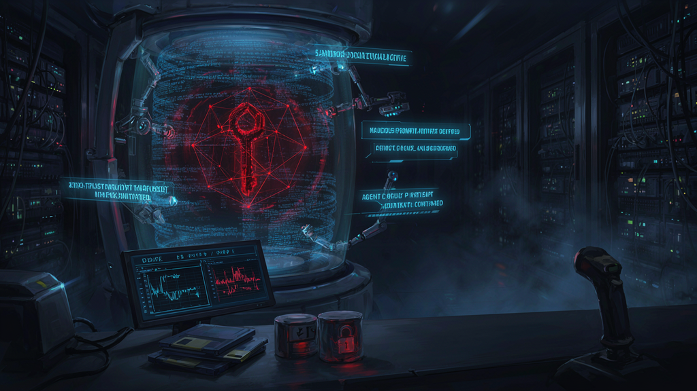

Right now, enterprises are scrambling to deploy autonomous AI agents. But in the rush to build the ultimate digital workforce, most mid-market companies are committing a critical security sin: they are giving their new AI agents "god-mode" credentials. Treat your AI like a trusted human employee, and you are basically handing the keys to your database to a highly efficient, speed-reading toddler who can be tricked by a malicious prompt in milliseconds.

With AWS officially getting approved to handle highly restricted workloads globally, the baseline for enterprise security has permanently evolved. Yet, out in the wild, companies are deploying autonomous agents with unchecked access to databases, unmonitored API connections, and flat network permissions. According to recent 2026 data, the average enterprise now has 144 times more non-human identities than human users, with AI agents being the fastest-growing segment of that population.

If your AI gets compromised, the blast radius isn't just a single stolen password it's your entire backend

## The "Agentic Zero Trust" Reality Check

The Cloud Security Alliance recently established a harsh but necessary baseline for 2026: Agentic Zero Trust. The core principle is simple: no AI agent should be trusted by default, regardless of its purpose or claimed capability.

- **The Flaw in Traditional Security:** Legacy security assumes that once a user (or bot) is inside the network, they belong there.
- **The Agentic Threat:** AI workloads are probabilistic and adaptive, meaning the exact same prompt can produce a compliant response on one request and a non-compliant response on the next. If an attacker uses prompt injection to embed hidden instructions into user input, your AI might autonomously exfiltrate sensitive data or execute malicious code.
- **The Fix:** Trust must be earned through demonstrated behavior and must be continuously verified through strict monitoring.

## How Arthurite Locks Down AI on AWS

At [Arthurite Integrated](https://arthuriteintegrated.com/), we don't just build serverless AI pipelines; we build blast doors. When we architect a cloud environment for multi-agent AI, we implement a strict zero-trust infrastructure so you can innovate without ending up on the evening news.

- **Identity is the Control Plane:** Every single AI agent operates under a dedicated AWS Identity and Access Management (IAM) role with strict, least-privilege permissions. We bind agent permissions tightly so that an agent can never exceed what its human principal is authorized to do.
- **Sandboxed Execution:** We deploy your AI agents as serverless AWS Lambda functions or containerized microservices within fully isolated Virtual Private Clouds (VPCs). If an agent goes rogue or hallucinates, it is trapped in a sandbox, unable to access your broader network.
- **Continuous Threat Detection:** We integrate tools like Amazon GuardDuty to continuously monitor agents and their network flows for anomalous behavior and potential threats.
- **Decoupled Communication:** Agent-to-agent communication is not a free-for-all. It is strictly managed and authenticated through Amazon API Gateway and event-driven services like Amazon EventBridge.

You wouldn't hire a brand-new employee, skip the background check, and hand them the master admin password on day one. It is time to stop doing it with your multi-agent systems. If you are ready to secure your generative AI workloads with a robust, zero-trust AWS architecture, let's talk about putting your agents in a proper sandbox.
