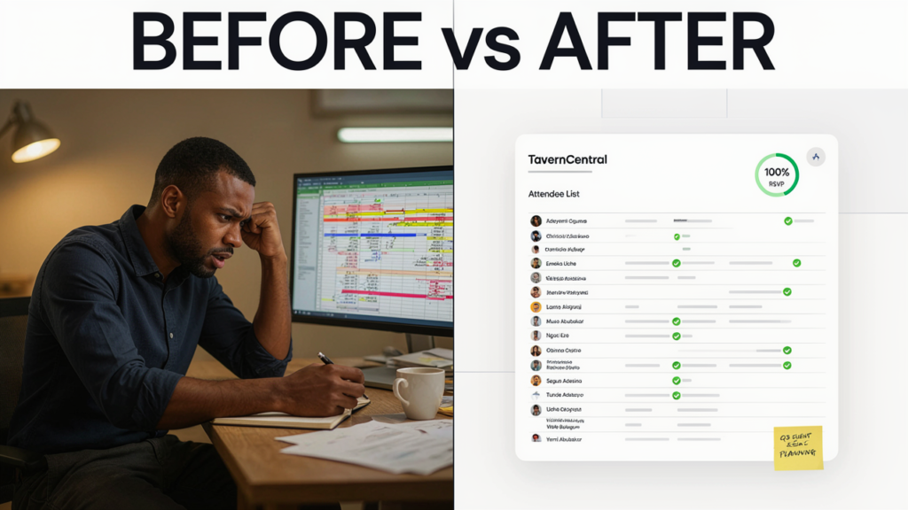

Let’s be honest: Organizing a company end-of-year party in Lagos is an extreme sport.

Right now, across the city, HR managers, admin teams, and startup founders are staring at the Q4 calendar with a mix of excitement and absolute dread. You want to reward your team for a hard year’s work, but between securing a venue that isn’t already booked out by Detty December ravers, arguing over the food budget, and managing a chaotic guestlist, the logistics can quickly become a nightmare.

If you want your 2026 corporate wrap party to actually feel like a celebration and not a stressful extension of the boardroom, here is your survival guide.

## **1. Ditch the Office, But Book Early**

Nothing kills the festive vibe faster than partying in the exact same room where you hold your Monday morning stand-ups. Your team needs a change of scenery.

Whether you are looking at a beachfront setup in Victoria Island, a private lounge in Ikeja, or an exclusive rooftop in Lekki, Q4 is peak season. Venues in Lagos start vanishing by late October. If you haven't locked down your location by the first week of November, you will end up settling for whatever is left over at double the price.

## **2. Ban the "Reply All" RSVP Email**

We have all seen it. An email goes out inviting the company to the end-of-year dinner, and suddenly, the company inbox is flooded with fifty "I'll be there!" and "Can I bring my spouse?" replies.

Trying to track RSVPs, plus-ones, and dietary restrictions (who is vegan, who is allergic to seafood) on a messy Excel spreadsheet is a guaranteed way to ensure someone's meal gets forgotten. You need a centralized system that tracks everything automatically so your HR team doesn't have to play detective.

## **3. Secure the Door (Because Free Jollof Attracts Everyone)**

Lagos is famous for party crashers. If you are hosting a corporate event at a public venue like a beach house or a hotel banquet hall, word gets around. Without a strict door policy, you will suddenly find random "cousins" and uninvited plus-threes eating the food your company paid for, while your actual employees are left holding empty plates.

You need a way to verify who is supposed to be in the room without forcing your team to stand at the door with a clipboard and a pen.

## **The Secret Weapon for Lagos Organizers: TavernCentral**

This is where the smart companies are upgrading their workflow. Instead of juggling WhatsApp messages, Google Forms, and printed lists, modern teams use TavernCentral to put their corporate event management on autopilot.

Here is why TavernCentral is the ultimate hack for your end-of-year party:

- Custom Corporate Registration Pages: Create a sleek, branded landing page where employees can RSVP, register their plus-ones, and select their dietary preferences all in one place.
- Real-Time Analytics: See exactly how many people are confirmed so you can give your caterer an accurate headcount and stop wasting the company budget on no-shows.
- VIP QR Code Check-In: This is the game-changer. TavernCentral automatically sends a unique digital QR ticket to every registered employee. At the door, just scan it with a smartphone. It takes two seconds, looks incredibly professional, and permanently eliminates gatecrashers.

Your team worked hard this year; they deserve a premium experience. And as the organizer, you deserve to actually enjoy the party instead of stressing over the guestlist.

Take the headache out of your end-of-year planning. Create your free corporate event page on TavernCentral today.
