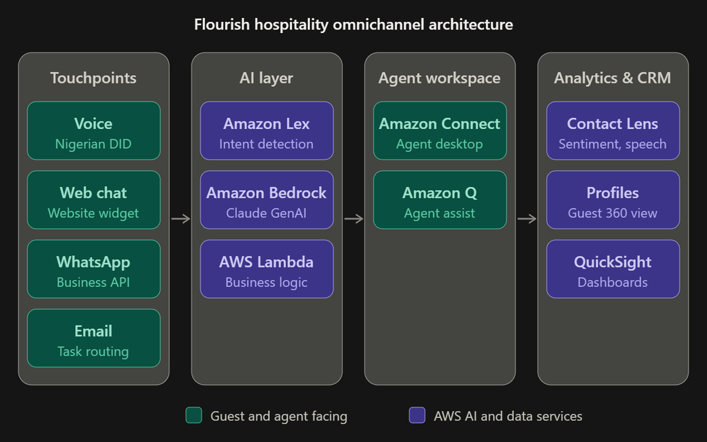

**By: Dauda Lawal – Web Developer**

In the competitive hospitality sector, exceptional guest service is no longer just a differentiator, it is the foundation of brand loyalty and revenue growth. However, many hospitality organizations still rely on fragmented, legacy communication channels that create operational bottlenecks, increase response times, and leave valuable guest data siloed.

When **Flourish Hospitality**, a leading multi-venue hospitality group in Nigeria, faced severe operational challenges due to legacy phone systems and unmonitored messaging channels, they partnered with **[Arthurite Integrated](https://arthuriteintegrated.com/)**.

]By deploying an intelligent, cloud-native, omnichannel contact center powered by **Amazon Connect** and **AWS Generative AI services**, Arthurite helped Flourish modernize its guest service operations, achieve **45% self-service automation**, and unlock millions in previously lost booking revenue.

## **The Challenge: Channel Fragmentation and Lost Revenue**

Prior to the modernization project, Flourish Hospitality managed approximately **8,400 monthly guest interactions** across disparate systems. This legacy setup introduced several operational frictions:

- **Fragmented Communication Channels:** Phone calls were routed through an aging PBX system, WhatsApp messages were handled informally on staff members' personal mobile phones without SLA tracking, and email inquiries sat in a shared inbox with an average **18-hour response time**.
- **High Wait Times and Abandonment:** Without automated call routing or interactive voice response (IVR), front-desk staff and agents were overwhelmed. Peak-hour hold times reached up to 8 minutes, driving a **12% call abandonment rate**.
- **No After-Hours Service:** Operating on a strict 8 AM – 9 PM schedule, late-night inquiries and bookings from international travelers went directly to voicemail. Unanswered inquiries resulted in an estimated **₦3.2 million per month in lost booking revenue**.
- **Lack of Context and Analytics:** Agents had no visibility into a guest's past bookings or preferences, forcing callers to re-explain their issues every time. Management lacked interaction analytics, sentiment tracking, or clear visibility into service gaps.

Flourish Hospitality needed a unified, scalable solution that could automate routine inquiries, route complex requests intelligently, operate 24/7, and integrate seamless guest intelligence into every conversation.

## **The Solution: An Intelligent Omnichannel Contact Center on AWS**

Arthurite Integrated designed and deployed a modern contact center architecture built natively on **Amazon Connect** and supported by advanced AWS Artificial Intelligence (AI) and Machine Learning (ML) services.

### **Key Solution Highlights**

1. **Omnichannel Desktop:** Voice, Web Chat, WhatsApp Business, and Email were consolidated into a single Amazon Connect agent desktop. Agents no longer switch applications, and cross-channel context is strictly preserved.
2. **AI Virtual Assistant (Amazon Lex & Amazon Bedrock):** An intelligent virtual assistant automates high-frequency routine inquiries, such as room availability checks, pricing queries, venue locations, and FAQ resolutions. Powered by **Amazon Bedrock (Claude)**, the assistant provides natural, generative answers pulled directly from Flourish’s knowledge base.
3. **Intelligent Natural-Language IVR:** Touch-tone menus were replaced with natural language processing. Callers state their intent naturally, and the system routes them to the appropriate department or automatically prioritizes VIP repeat guests based on phone number matching.
4. **24/7 Coverage:** Outside regular operating hours, the AI assistant continues to process availability checks, take automated reservations via secure links, and capture complex requests for next-day agent follow-ups.
5. **Real-Time Analytics & Agent Assist:** **Amazon Connect Contact Lens** transcribes calls in real time, monitors guest sentiment, and alerts supervisors if sentiment degrades. Simultaneously, **Amazon Q in Connect** provides live agents with suggested responses and relevant knowledge articles during active calls.

## **Key Impact & Business Outcomes**

By transitioning from a manual, phone-first operation to an AI-driven omnichannel platform, Flourish Hospitality transformed its cost structure and service quality:

- **45% Self-Service Containment:** Over 3,700 routine monthly interactions are now handled completely by the AI assistant without human agent intervention, saving an estimated 252 agent-hours per month.
- **Drastic Reduction in Wait Times:** Average speed-to-answer dropped from **3.8 minutes to under 30 seconds**, while call abandonment dropped from **12% to under 3%**.
- **Revenue Recovery:** Capturing after-hours inquiries and eliminating call abandonment recovered an estimated **₦2.6 million per month** in previously lost booking revenue.
- **Faster Response Times Across Channels:** WhatsApp response times improved from hours to **under 15 seconds** (via bot-first engagement), and email resolution times fell from 18 hours to **under 2 hours**.
- **Optimized Telephony Costs:** Moving from fixed legacy PBX maintenance to Amazon Connect’s pay-per-use cloud model reduced monthly infrastructure and telephony overhead by nearly **50%**.

## **AWS Travel & Hospitality Competency Alignment**

This deployment demonstrates Arthurite Integrated’s capabilities in delivering specialized AWS solutions for the travel, lodging, and hospitality sector:

- **Contact Center Modernization:** Migration from legacy infrastructure to a cloud-native, pay-per-use contact center.
- **Generative AI Guest Services:** Combining Amazon Lex and Amazon Bedrock to deliver human-like conversational experiences across voice and digital channels.
- **Unified Customer Data:** Leveraging Amazon Connect Customer Profiles to surface guest history, stay preferences, and feedback to agents instantly.
- **Operational Intelligence:** Transforming unformatted voice and text interactions into structured data with Amazon QuickSight and Contact Lens.

## **Transform Your Customer Operations with Arthurite Integrated**

Whether you operate in hospitality, retail, financial services, or logistics, fragmented customer communications cost your business revenue and customer goodwill every day.

At **Arthurite Integrated**, we specialize in designing, deploying, and managing cloud-native AWS solutions that lower operational costs, enhance customer satisfaction, and drive business growth.

**Ready to modernize your contact center?**

[Contact our Lead Solutions Engineering team today](mailto:arthuriteintegrated@gmail.com) to schedule an architecture discovery workshop.
