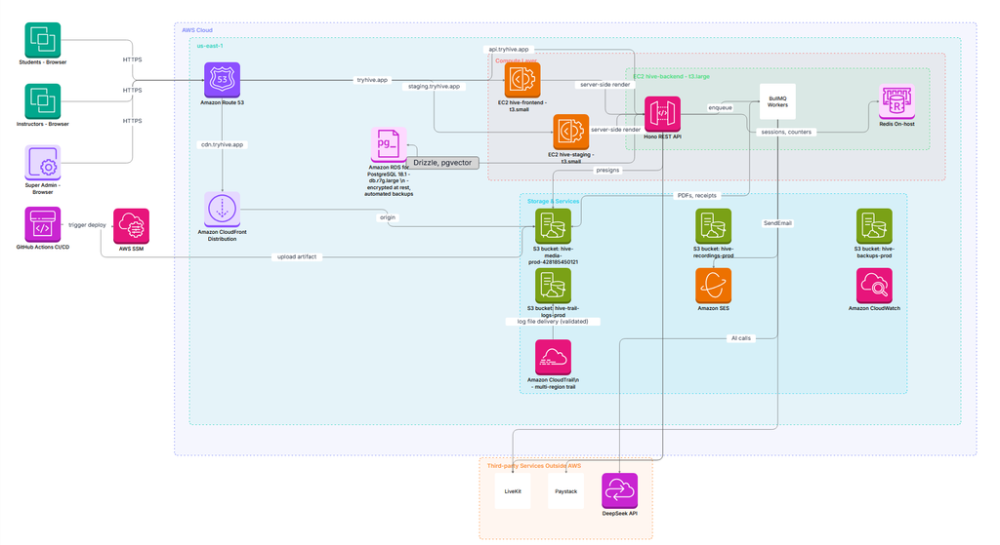

*How Hive brings courses, live teaching, assessments, AI assistance, and naira payments into one learning platform—built on AWS.*

A course can begin in a group chat. Running a teaching business there is harder.

The lessons sit in one place. Payment confirmations arrive somewhere else. Attendance lives in a spreadsheet, assignments disappear into message threads, and the instructor becomes the person responsible for holding everything together.

Hive was built to connect those pieces.

Developed by Arthurite Integrated with Fernwood Systems and DDB AI, Hive brings the teaching journey into one browser-based platform—from joining a learning community and paying for a course to completing an assessment and receiving a verifiable certificate.

## About the Platform: Built Around How Nigerian Instructors Teach

Hive is a teaching marketplace and learning platform designed for Nigeria. It serves independent instructors, academies, bootcamps, and training teams that need to manage both learning and the business behind it.

Instructors can build communities, publish courses, teach live, assess students, and withdraw earnings to verified Nigerian bank accounts. Students can follow lessons, submit assignments, take assessments, and earn certificates. Parents can monitor the progress of children linked to their accounts.

The experience runs in a browser, giving instructors and learners access without a separate application installation.

Its central idea is straightforward: the community, classroom, payment record, and learning record should work together.

## The Challenge: Teaching Across Tools That Do Not Talk to Each Other

When teaching relies on disconnected tools, every additional student creates more administrative work.

An instructor must match a bank transfer to a name, decide who should receive course access, track submitted assignments, record results, and determine who qualifies for a certificate. Students depend on those manual steps to keep moving.

Hive’s project documents identify several connected challenges:

- **Fragmented administration:** Communities, lessons, payments, and assessment records sit across separate systems.
- **Payment friction:** Manual transfers make payment verification and enrollment harder to coordinate.
- **Limited assessment evidence:** Chat-based quizzes leave instructors without a consistent record of attempts, answers, and completion.
- **Unclear earnings:** Without a connected ledger, tracking income and withdrawals becomes another reconciliation task.
- **Access constraints:** Learners on mobile devices and modest connections need lightweight pages and efficient media delivery.

These problems affect more than convenience. They shape how confidently an instructor can grow a course into a repeatable teaching business.

## The Solution: Hive—One Platform for the Teaching Journey

Arthurite Integrated and its delivery partners built Hive to connect learning activity with the records and workflows that support it.

### Communities That Lead Into Structured Learning

Instructors can bring their audience into a community through join links, then organise teaching into courses, modules, and lessons.

Hive supports nine lesson formats: video, PDF, live class, quiz, assignment, text, Google Drive file, PowerPoint deck, and timed assessment.

That flexibility lets an instructor combine explanation, discussion, practice, and evaluation within the same course. Sequential access and scheduled module unlocks are enforced by the backend, helping instructors control how students progress through the material.

### Naira Payments Connected to Enrollment and Earnings

Hive connects Paystack hosted checkout to course access and instructor accounting.

Students pay instructor-set prices in naira. The platform verifies the payment before granting access and records the corresponding financial entries in an append-only ledger. Signature verification and transaction-reference checks help prevent repeated payment notifications from creating duplicate entries.

Instructors can request withdrawals to verified Nigerian bank accounts, connecting the sale of a course to a traceable earnings record.

### Assessments With a Record Behind the Result

Hive’s assessment engine supports timed, single-attempt assessments with server-side deadlines and autosave across page reloads.

Instructors can also grade assignments, provide feedback, and return work for revision. Certificates are issued only when the course’s eligibility rules are met and can be verified by a third party.

This connects the certificate to recorded learning and assessment activity.

### AI Assistance Grounded in the Course

Hive includes a course-bound AI tutor designed to answer from the learner’s enrolled course material and decline questions outside that scope.

The purpose is focused assistance: helping a student work through the material they are studying while keeping the course content central to the response.

The tutor is implemented through an AI provider integration. Migration to Amazon Bedrock is in progress, while AI grading assistance and an AI course builder remain under development.

## The Technology: AWS Infrastructure Behind the Learning Experience

Hive’s deployed environment runs in AWS’s us-east-1 region.

Amazon EC2 hosts the frontend, backend, and staging environments. Amazon RDS for PostgreSQL stores the connected records behind users, communities, courses, enrollments, assessments, payments, and certificates, with pgvector supporting AI similarity work.

Lesson media is stored in private Amazon S3 buckets and delivered through Amazon CloudFront. This keeps media delivery separate from application processing and uses AWS’s edge network to serve learning content.

The supporting services include:

- **Amazon Route 53** for application and media domain routing.
- **Amazon SES** for transactional email.
- **Amazon CloudWatch** for monitoring and alarms.
- **AWS Systems Manager** for administration and deployments without inbound SSH.
- **GitHub Actions** for building and releasing application updates.

Automated database backups provide seven-day retention and point-in-time recovery. Encryption protects stored data, while backend access checks govern roles, ownership, and enrollment permissions.

## Progress So Far: A Deployed Foundation With Measured Operating Costs

Hive is deployed on AWS, with core learning and payment capabilities implemented. Its October 2026 delivery records show the following progress:

| Area | Documented progress |
| --- | --- |
| Course delivery | Nine lesson formats implemented |
| Assessment | Timed assessments, autosave, and assignment grading implemented |
| Payments | Paystack enrollment payments and instructor ledger implemented |
| Credentials | Certificate issuance and verification implemented |
| AI support | Course-bound tutor implemented |
| AWS infrastructure cost | $266.62 measured for September 2026 |

The cost figure reflects the deployed environment at its current, pre-general-availability usage. Payment processing, live-session services, and external AI provider charges are tracked separately.

Broader adoption and learning outcomes will be evaluated through the planned pilot.

## What Comes Next: Preparing for Wider Use

Hive’s next stages focus on validating and strengthening the platform before general availability.

The programme targets 10,000 registered users and 500 concurrent users in Year 1. Load testing at that concurrency remains pending, alongside availability validation, recovery exercises, and further security hardening.

Planned infrastructure work includes Multi-AZ resilience, evaluation of managed cache and database upgrades, and the Amazon Bedrock migration.

The closed beta is scheduled for December 2026, with general availability targeted by 1 March 2027.

## Strategic Significance: Giving Teaching a Connected Foundation

Hive brings the operational side of education into the same system as the learning experience.

For instructors, that means a clearer connection between the course they publish, the students they teach, the assessments they grade, and the earnings they withdraw. For learners, it means a continuous path from enrollment to evidence of completion.

Arthurite Integrated and its partners are building Hive around that connection: a platform where teaching, learning, and the business supporting them can grow together.
