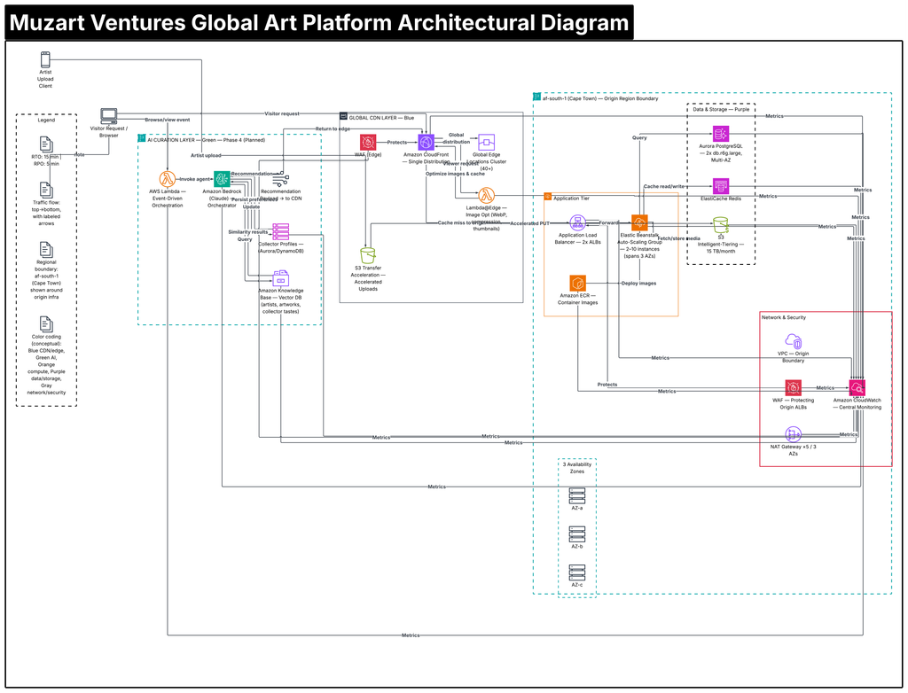

Muzart Ventures connected more than 1,200 African artists with an international audience of over 45,000 art enthusiasts. Its infrastructure struggled to deliver the experience that audience expected.

International visitors faced slow pages, and exhibition launches created traffic spikes that disrupted service. For a business built around visual discovery, those delays affected both engagement and sales.

Working with Arthurite Integrated, Muzart redesigned its platform around global content delivery and an application origin in Cape Town.

## Inside the Platform Architecture

*Muzart Ventures’ reference architecture separates global content delivery, regional application infrastructure, and a planned AI curation layer.*

Amazon CloudFront provides the global delivery layer, supported by Lambda@Edge image processing. Public media can be cached closer to visitors, while the origin infrastructure is located in the AWS Africa (Cape Town) Region.

The supplied diagram shows an application tier using Elastic Beanstalk, application load balancing, and scaling across three Availability Zones.

Its storage and data services include Amazon Aurora PostgreSQL, Amazon ElastiCache for Redis, and Amazon S3. Amazon ECR supports container-image storage, while Amazon CloudWatch gathers operational metrics.

AWS WAF appears at both the edge and the origin application layer.

The diagram separately labels an AI curation layer as **planned**. That design includes Amazon Bedrock, Lambda orchestration, collector profiles, and a knowledge base to support future discovery and recommendation features.

## Faster Pages, More Reliable Exhibitions

The published case study reports:

- Global page loading improved from **8.2 seconds to 1.7 seconds**.
- Visitor abandonment decreased from **42% to 8%**.
- Conversion increased by **280%**.
- Availability reached **99.96% across 15 virtual exhibitions**.
- Cost per active user fell from **$2.33 to $0.79**.

## Supporting the Moments That Matter

The improved platform gave Muzart a stronger foundation for exhibitions, where sudden audience growth had previously caused disruption.

**Arthurite Integrated helps digital businesses build AWS platforms for growing audiences. Contact our team to explore your next stage of growth.**

*Adapted from the [published Muzart Ventures case study](https://arthuriteintegrated.com/the-exhibition-that-almost-didnt-happen-how-muzart-ventures-went-global-without-leaving-africa-behind/).*
