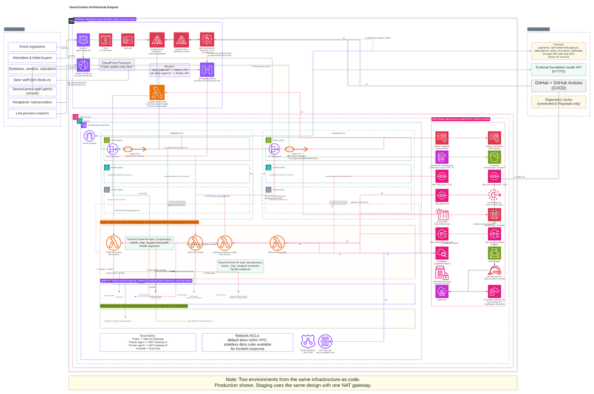

*A case study by Arthurite Integrated*

Events don't wait. When thousands of people rush to register for a popular conference or community gathering, the platform behind that registration form has to hold steady — no spinning loaders, no failed payments, no "try again later." For TavernCentral, a Lagos-based event management and ticketing SaaS platform, that reliability isn't a nice-to-have. It's the product.

TavernCentral gives organisers everything they need to run events — from branded event pages and QR code check-in to email campaigns, paid ticketing through Paystack, and an AI-powered campaign assistant called Cedric. Organisations of any size use it: businesses, NGOs, schools, faith groups, and professional associations across Nigeria. Guests never need to create an account. They register, get a confirmation email with a PDF ticket, and show up. Simple.

But behind that simplicity is a serious engineering challenge.

**The Problem: Spiky Traffic, Tight Budgets, Strict Isolation**

TavernCentral runs on a freemium model. A large share of its users are on the Free plan — unlimited events, unlimited guests, zero cost. That means the platform has to be cheap to run when things are quiet, and ready to scale instantly when a popular event drops. Registration spikes are unpredictable and sharp.

On top of that, every organiser's data has to stay strictly separated. Multi-tenancy isn't optional — it's a trust requirement. And TavernCentral's users are often on mobile devices with slower connections, so every API call and page load has to be lean.

These constraints pointed in one direction: fully serverless on AWS.

**The Architecture: Serverless, End to End**

TavernCentral's production stack runs entirely on managed AWS services:

- **AWS Lambda** handles all compute — API logic, email dispatch, QR code generation, payment webhook processing, and the Cedric AI assistant.
- **Amazon API Gateway** fronts the REST APIs, handling authentication, throttling, and request routing.
- **Amazon DynamoDB** stores all event, registration, and ticketing data with single-digit-millisecond reads, and its on-demand capacity mode means TavernCentral pays only for actual throughput.
- **Amazon Cognito** manages organiser authentication — sign-up, sign-in, token refresh — without TavernCentral ever touching a password.
- **Amazon S3 + CloudFront** serve the React-based frontend, event images, and PDF tickets at edge locations closest to Nigerian users.
- **Amazon SES** delivers transactional emails: registration confirmations, ticket PDFs, and organiser-scheduled campaigns.
- **Amazon SQS** decouples heavy processing — bulk email sends, payment reconciliation, report generation — from the synchronous API path.
- **Amazon EventBridge** orchestrates event-driven workflows: scheduled email campaigns fire on time, post-event analytics run automatically, and stale sessions clean themselves up.

Every one of these services is defined as code.

**Infrastructure as Code: AWS CDK v2 in TypeScript**

TavernCentral's entire AWS environment — Lambda functions, API Gateway routes, DynamoDB tables, Cognito user pools, S3 buckets, CloudFront distributions, SQS queues, EventBridge rules, IAM roles, and every permission binding them together — lives in a single AWS CDK v2 project written in TypeScript.

CDK isn't just a deployment tool here; it's the source of truth. Every infrastructure change goes through the same review and deployment process as application code. There's no console drift, no undocumented resources, and no "I think someone changed that security group manually."

The CDK project is structured around logical constructs:

- **EventConstruct** — bundles the DynamoDB table, Lambda handlers, and API Gateway routes for event CRUD operations.
- **RegistrationConstruct** — the registration and ticketing pipeline, including SQS queues for async confirmation emails and payment webhooks.
- **AuthConstruct** — Cognito user pool, app client, and authoriser configuration.
- **CdnConstruct** — S3 origin, CloudFront distribution, OAI, and cache behaviours for the frontend.

This modularity means features ship as isolated, testable units. Adding a new capability — say, badge printing for Premium users — doesn't require understanding the entire stack. You write a new construct, wire it to the relevant API route, and the CDK handles the dependency graph.

**CI/CD: GitHub Actions From Commit to Production**

TavernCentral's deployment pipeline runs on GitHub Actions, with every push triggering a consistent, automated workflow:

1. **Linting & Static Analysis** — ESLint validates TypeScript code quality. npm audit flags known vulnerabilities in dependencies.
2. **Unit & Integration Tests** — Jest runs the application test suite. CDK assertion tests validate that synthesised CloudFormation templates contain the expected resources, IAM policies, and configurations — catching misconfigurations before they reach AWS.
3. **CDK Synth & Diff** — cdk synth generates the CloudFormation template. cdk diff runs against the target environment so reviewers can see exactly what infrastructure will change.
4. **Deployment** — cdk deploy pushes to the target environment. GitHub OIDC federation provides short-lived AWS credentials through STS AssumeRoleWithWebIdentity — no long-lived AWS access keys stored anywhere.
5. **Post-Deployment Validation** — Smoke tests hit key API endpoints to confirm the deployment is healthy.

Environment promotion follows a branch-based model: feature branches deploy to a development environment, the main branch deploys to staging, and production deployments require explicit approval through GitHub environment protection rules.

**Security: No Stored Secrets, No Exceptions**

Security decisions are baked into the architecture, not bolted on:

- **GitHub OIDC Federation** — Every GitHub Actions workflow authenticates to AWS using OpenID Connect. The OIDC provider is scoped to TavernCentral's specific repository and branch patterns. There are no IAM user credentials, no stored access keys, no secrets to rotate. The STS tokens expire in minutes.
- **SSM Parameter Store (SecureString)** — API keys for Paystack, SES sending credentials, and other sensitive configuration values are stored as SecureString parameters in AWS Systems Manager Parameter Store, encrypted at rest with KMS. Lambda functions retrieve them at runtime; they never appear in CDK code, environment variables, or CI/CD logs.
- **Least-Privilege IAM** — Every Lambda function has its own execution role with only the permissions it needs. The registration handler can write to the registrations DynamoDB table and publish to the confirmation SQS queue — nothing more.
- **CDK Assertion Tests for Security** — Tests verify that S3 buckets have public access blocked, DynamoDB tables have encryption enabled, and IAM policies don't contain wildcard resource permissions.

**What Changed for TavernCentral**

Before working with Arthurite Integrated, TavernCentral's infrastructure was partially defined in CDK but deployed manually, with limited test coverage and ad-hoc security reviews. The DevOps engagement delivered:

- **Fully automated deployments** — from commit to production in under 15 minutes, with zero manual AWS Console interaction.
- **Infrastructure confidence** — CDK assertion tests catch breaking changes before deployment. Developers know that if the pipeline passes, the infrastructure is correct.
- **Cost discipline** — the serverless architecture means TavernCentral's AWS bill scales linearly with usage. During low-traffic periods, compute costs drop to near zero. DynamoDB on-demand pricing eliminates capacity planning guesswork.
- **Faster feature delivery** — the modular CDK construct pattern and automated pipeline mean new features (like the Premium badge designer or the Cedric AI assistant) ship in days, not weeks.
- **Security by default** — OIDC federation, SSM SecureString, and automated security scanning are part of every deployment. Security isn't a separate review; it's a pipeline gate.

**The Stack at a Glance**

| **Layer** | **Service** | **Managed By** |
| --- | --- | --- |
| Compute | AWS Lambda | CDK v2 (TypeScript) |
| API | Amazon API Gateway | CDK v2 |
| Database | Amazon DynamoDB | CDK v2 |
| Authentication | Amazon Cognito | CDK v2 |
| Frontend Hosting | S3 + CloudFront | CDK v2 |
| Email | Amazon SES | CDK v2 |
| Async Processing | Amazon SQS | CDK v2 |
| Event Orchestration | Amazon EventBridge | CDK v2 |
| Secrets | SSM Parameter Store | CDK v2 |
| CI/CD | GitHub Actions + OIDC | Workflow YAML |
| Payments | Paystack (external) | Lambda integration |

**For Organisers, It Just Works**

None of this complexity is visible to the organiser creating their next conference or the guest scanning a QR code at the door. That's the point. The serverless architecture absorbs the spikes. The CI/CD pipeline catches the bugs. The IaC keeps the infrastructure honest. And TavernCentral keeps doing what it does best: making events easy.

*Arthurite Integrated is an AWS Advanced Tier Consulting Partner specialising in DevOps, serverless architecture, and cloud-native solutions. We help startups and ISVs build infrastructure that scales with their ambitions.*

*Learn more at [*arthuriteintegrated.com*](https://arthuriteintegrated.com/)*
