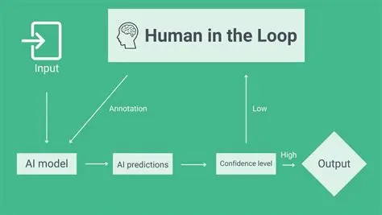
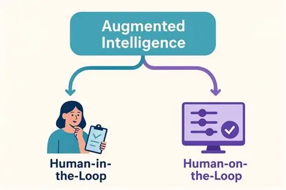

**By: Dauda Lawal – Web Developer**

Artificial intelligence is transforming how businesses operate, make decisions, serve customers, and manage everyday workflows. From intelligent chatbots and automated document processing to AI-powered analytics and agentic systems, organizations are increasingly relying on AI to improve efficiency and productivity.

However, as AI systems become more capable, an important question emerges: **How can businesses benefit from AI automation without losing human judgment, accountability, and control?**

The answer lies in Human-in-the-Loop (HITL) AI.

Human-in-the-Loop AI combines artificial intelligence capabilities with human supervision, expertise, and decision-making. Instead of allowing AI systems to operate entirely independently, this approach introduces people into critical stages of the AI workflow. Humans can review outputs, correct mistakes, provide feedback, approve sensitive decisions, and improve the overall performance of Artificial intelligence systems.

For businesses adopting AI, Human-in-the-Loop is more than a technical design choice. It is a practical strategy for building reliable, responsible, and business-ready Artificial intelligence solutions.

## **What Is Human-in-the-Loop AI?**

What Is Human-in-the-Loop AI?

Human-in-the-Loop AI is an approach to artificial intelligence that integrates human involvement into the development, operation, evaluation, or decision-making processes of an Artificial intelligence system.

In a traditional automated workflow, an AI model receives information, processes it, and produces an output. Depending on its configuration, the system may automatically execute an action based on that output.

With Human-in-the-Loop AI, people remain involved where their expertise or judgment adds value.

For example, an AI-powered customer support system might automatically answer simple questions about opening hours or product availability. However, when a customer requests a refund, reports a serious complaint, or raises a sensitive issue, the system can transfer the conversation to a human support representative.

This approach allows businesses to automate repetitive activities while preserving human oversight for complex or consequential decisions.

Human involvement can take several forms:

- Reviewing AI-generated responses before publication.
- Approving financial transactions or sensitive business actions.
- Correcting inaccurate predictions or classifications.
- Providing feedback that improves future AI performance.
- Handling exceptions that automated systems cannot confidently resolve.
- Monitoring AI behavior for quality, fairness, and compliance.

The objective is not to eliminate automation. Instead, it is to establish the right balance between AI capabilities and human expertise.

## **Why Human Oversight Matters in Modern AI Systems**

AI systems can process large volumes of information, identify patterns, and generate useful recommendations. Nevertheless, they can also produce inaccurate answers, misunderstand context, or make decisions that conflict with business policies.

These limitations become particularly important when AI operates in environments involving customers, financial transactions, sensitive information, or operational decisions.

### **1. Reducing AI Errors and Hallucinations**

Generative AI models can produce convincing responses that contain incorrect information. These errors, commonly described as hallucinations, can create significant problems when organizations rely on AI-generated content without verification.

For instance, an AI assistant supporting a financial services company might provide an incorrect explanation of a transaction or misinterpret a customer's account information.

Human reviewers can identify these mistakes before they reach customers or influence business decisions.

Organizations can also use confidence thresholds, automated validation, and trusted data sources to determine when human review is necessary.

This combination improves the reliability of AI-generated outputs and reduces the likelihood of errors becoming operational problems.

### **2. Maintaining Accountability**

AI systems can recommend actions, but businesses must establish who remains responsible for important decisions.

Human-in-the-Loop AI provides a clear mechanism for assigning decision ownership.

For example, an AI system might analyze a loan application and identify potential risks. However, a qualified human reviewer may need to evaluate the recommendation before approving or rejecting the application.

This distinction is important because AI-generated recommendations should not automatically become final business decisions.

Organizations should define approval responsibilities, escalation procedures, audit records, and intervention mechanisms before deploying AI in consequential workflows.

### **3. Building Customer Trust**

Customers expect businesses to provide accurate information, protect their data, and resolve problems appropriately.

Although AI can improve response times, customers may become frustrated when automated systems cannot understand their circumstances or provide meaningful assistance.

Human-in-the-Loop AI creates opportunities for customers to access human support when necessary.

For example, an AI chatbot can handle routine inquiries while escalating complicated complaints to experienced customer service representatives.

This approach combines the speed of automation with the empathy, communication skills, and contextual understanding that human employees provide.

## **How Human-in-the-Loop AI Works**

A Human-in-the-Loop AI workflow typically combines data processing, AI inference, decision rules, human review, and feedback.

Although implementations differ, the process generally follows these stages.

### **Step 1: Collect and Prepare Data**

The AI system receives information from approved sources, such as business databases, customer interactions, documents, application records, or operational systems.

Organizations must ensure that the data is relevant, accurate, appropriately protected, and suitable for the intended AI task.

### **Step 2: Generate an AI Prediction or Recommendation**

The AI model processes the information and produces an output.

Depending on the application, this output could be a classification, recommendation, summary, generated response, risk score, or proposed action.

### **Step 3: Evaluate the Output**

The system applies business rules, validation checks, confidence thresholds, or risk classifications.

Simple, low-risk outputs may proceed automatically.

However, uncertain outputs or decisions involving significant consequences should trigger additional review.

### **Step 4: Request Human Review**

A human reviewer receives the AI output alongside relevant supporting information.

The reviewer can approve the recommendation, reject it, correct the output, request additional information, or escalate the case.

The review process should provide enough context for the person to make an informed decision.

### **Step 5: Execute the Approved Action**

Once the required approval is received, the system can execute the action through an authorized application, API, or workflow.

For high-risk activities, the system should enforce approval requirements rather than relying only on employees to remember them.

### **Step 6: Capture Feedback and Improve**

The system records relevant review outcomes and corrections.

Teams can use this feedback to improve prompts, business rules, evaluation datasets, model performance, and workflow design.

However, human feedback does not automatically retrain a model. Organizations must deliberately configure and validate any learning or model-update process.

## **Human-in-the-Loop AI vs. Human-on-the-Loop AI**

Human-in-the-Loop AI vs. Human-on-the-Loop AI

Businesses often use different levels of human involvement depending on the application and its risk profile.

**Human-in-the-Loop (HITL)** generally means people actively participate in a workflow, such as reviewing, correcting, or approving AI outputs before the system proceeds.

**Human-on-the-Loop (HOTL)** generally means AI performs tasks with greater independence while humans monitor its behavior and intervene when necessary.

For example, a customer support AI may require human approval before sending certain sensitive responses. This is a HITL workflow.

An AI monitoring system that automatically detects operational issues and allows engineers to intervene when alerts arise may follow a HOTL approach.

Neither model is universally better.

The appropriate level of human involvement depends on the consequences of errors, the reliability of the AI system, the reversibility of actions, and the organization's operational readiness.

## **Practical Business Applications of Human-in-the-Loop AI**

Human-in-the-Loop AI can support numerous business functions.

### **Customer Service and AI Chatbots**

AI-powered customer service platforms can answer frequently asked questions, retrieve information, summarize conversations, and recommend solutions.

Human oversight becomes particularly valuable when customers raise complex complaints, request exceptions, or discuss sensitive matters.

Businesses can configure escalation rules that transfer these conversations to human representatives.

This improves customer experience while allowing support teams to concentrate on cases that require greater attention.

### **Financial Services and Fraud Detection**

AI systems can analyze transactions, identify unusual patterns, and flag potentially fraudulent activity.

However, suspicious transactions may require additional investigation before a business blocks an account or rejects a legitimate payment.

Human reviewers can examine supporting evidence, assess the circumstances, and determine the appropriate response.

This approach helps organizations balance fraud prevention with customer convenience.

### **Healthcare and Medical Support**

AI can assist healthcare professionals by summarizing records, identifying patterns, and supporting clinical workflows.

Nevertheless, medical decisions require appropriate professional judgment.

Human-in-the-Loop AI allows qualified healthcare professionals to review AI-generated information and make decisions based on clinical evidence, patient circumstances, and professional responsibilities.

AI should support qualified professionals rather than replace their accountability.

### **Content Creation and Marketing**

Marketing teams can use AI to generate blog drafts, campaign ideas, product descriptions, social media content, and customer communication.

Human editors can review the material for accuracy, brand consistency, originality, tone, and compliance.

This process helps businesses increase content production without sacrificing editorial quality.

### **IT Operations and Cloud Infrastructure**

AI can help cloud engineering teams analyze logs, identify unusual activity, summarize incidents, and recommend remediation steps.

For example, an AI assistant might detect an AWS infrastructure issue and suggest a configuration change.

A human engineer can review the recommendation, assess the potential impact, and approve the change before deployment.

For destructive operations, production infrastructure changes, or security-sensitive actions, approval controls and rollback mechanisms are particularly important.

## **Implementing Human-in-the-Loop AI on AWS**

AWS provides cloud services that organizations can combine to build AI applications with human review, workflow orchestration, monitoring, and controlled execution.

The architecture depends on the use case, but several AWS services can support this approach.

**Amazon Bedrock:** Organizations can use Amazon Bedrock to build generative AI applications and AI agents. Applications can generate responses, summarize information, and recommend actions while incorporating approval steps into the surrounding workflow.

**AWS Lambda:** Lambda can execute application logic, validate AI outputs, apply business rules, and route tasks to appropriate review processes.

**AWS Step Functions:** Step Functions can orchestrate multi-step workflows, including AI inference, conditional branching, human approval, and subsequent execution.

**Amazon SQS and Amazon SNS:** These services can support asynchronous processing and notifications. For example, an application can place review tasks in a queue and notify the appropriate team when a decision is required.

**Amazon CloudWatch:** CloudWatch can help teams monitor application behavior, collect logs, track operational metrics, and identify workflow failures.

**Amazon DynamoDB:** DynamoDB can store workflow state, review status, approval records, and other application data when appropriate.

A simplified architecture could follow this process:

1. An application receives a customer request or business event.
2. AWS Lambda processes the request and invokes an AI model through Amazon Bedrock.
3. The application evaluates the output using validation rules and risk thresholds.
4. Low-risk tasks continue automatically within approved permissions.
5. High-risk or uncertain tasks enter a human review workflow.
6. AWS Step Functions manages the approval process and subsequent execution.
7. CloudWatch collects operational logs and metrics.
8. The application records review decisions for auditing and improvement.

Organizations should also implement appropriate IAM permissions, data protection, approval identity verification, and safeguards against unauthorized AI actions.

The key principle is to design human oversight into the workflow rather than adding it after deployment.

## **Human-in-the-Loop AI and Agentic AI**

The emergence of agentic AI makes human oversight increasingly important.

AI agents can interact with tools, retrieve information, execute workflows, and complete tasks across connected systems.

Although these capabilities create opportunities for automation, they also introduce additional operational risks.

An AI agent with access to business applications might attempt to modify records, send messages, approve requests, or execute infrastructure operations.

Organizations should therefore define clear boundaries around what agents can do independently.

For example:

- Allow agents to retrieve approved information automatically.
- Permit low-risk actions within predefined limits.
- Require approval before sending sensitive communications.
- Restrict access to financial or confidential systems.
- Require human authorization for high-impact or irreversible actions.
- Maintain logs of agent decisions and tool usage.
- Provide mechanisms to stop or disable unsafe workflows.

Human oversight should be proportional to risk.

A system that automatically categorizes internal documents does not necessarily require the same controls as an agent capable of initiating payments or modifying production infrastructure.

## **Best Practices for Implementing Human-in-the-Loop AI**

Organizations should consider the following practices when designing AI workflows.

**Start with a clearly defined business problem.** Identify the task AI should support, the expected business outcome, and the decisions that require human involvement.

**Classify decisions by risk.** Determine which activities can proceed automatically and which require approval, additional validation, or escalation.

**Establish meaningful review processes.** Give reviewers sufficient information, time, authority, and training to evaluate AI outputs effectively.

**Avoid unnecessary approval bottlenecks.** Human review should focus on decisions where it provides meaningful value. Reviewing every low-risk action can reduce productivity without improving safety.

**Protect sensitive information.** Apply access controls, data minimization, encryption, and appropriate privacy policies throughout the workflow.

**Monitor system performance.** Track accuracy, escalation rates, approval times, correction rates, and operational failures.

**Keep humans accountable.** Define who can approve, reject, override, or stop AI-driven actions.

**Test before increasing autonomy.** Evaluate the system under realistic conditions and expand automation only when performance and operational controls demonstrate reliability.

## **The Future of AI Is Human-Centered**

Artificial intelligence will continue to reshape business operations, but successful adoption requires more than deploying powerful models.

Organizations must also establish the processes, safeguards, and expertise necessary to use AI responsibly.

Human-in-the-Loop AI provides a practical framework for combining automation with human judgment.

By allowing AI systems to handle repetitive tasks while people oversee important decisions, businesses can improve productivity, strengthen accountability, and build greater confidence in AI-powered applications.

For organizations exploring generative AI, intelligent automation, or agentic AI, the most effective strategy is not necessarily to remove humans from every workflow.

It is to determine where AI can operate independently, where human expertise is essential, and how both can work together to achieve better outcomes.

**At Arthurite Integrated, we help businesses explore practical AI solutions, cloud architecture, and intelligent automation strategies that align with their operational needs.**

Whether your organization is evaluating AI adoption, developing AI-powered applications, or integrating intelligent workflows into existing systems, the right approach begins with understanding your business challenges and designing technology around measurable outcomes.

Contact Arthurite Integrated at [**Info@arthuriteintegrated.com**](https://arthuriteintegrated.com/contact/) to discuss your AI opportunities and explore how human-centered AI solutions can support your business.

For more insights on this topic, check out our latest article: [[Read the New Blog](https://arthuriteintegrated.com/blog-posts/)].
