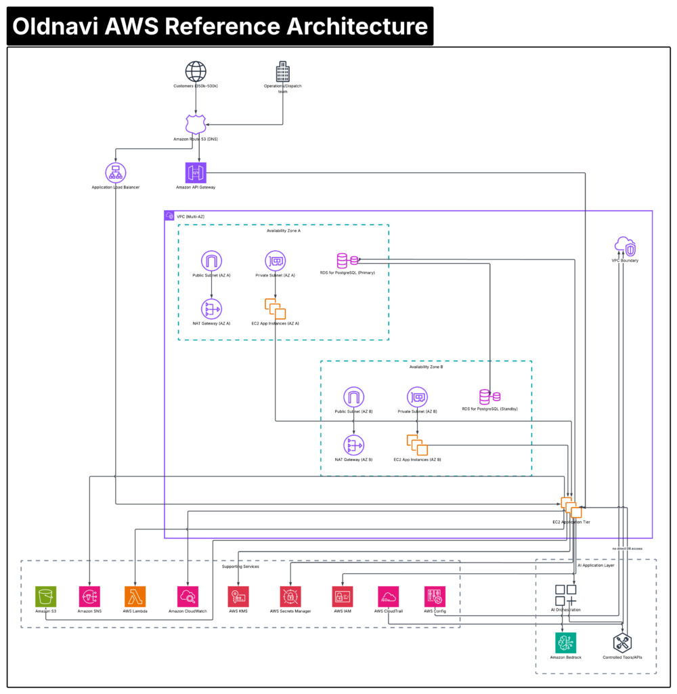

When a business grows faster than its underlying infrastructure, operational friction quickly transitions from a minor inconvenience to an existential threat. For logistics and dispatch operations, scaling up volume traditionally meant multiplying headcount—adding more dispatchers, monitoring more chat groups, and continuously cross-checking static spreadsheets.

Until recently, Oldnavi operated in this exact operational reality. Customer bookings, urgent schedule changes, and field updates arrived via a barrage of WhatsApp messages. Operations teams worked tirelessly across fragmented channels, manually re-keying data into central systems while trying to keep dispatch pipelines moving. But human bandwidth does not scale endlessly. As transaction volumes expanded, operational debt began to compound, revealing the sharp limits of manual processes.

**The Problem: When WhatsApp Becomes a Bottleneck**

At operational peak, the friction points in Oldnavi’s manual workflow were creating severe performance headwinds:

- **30-Hour Weekly Triage Drain:** Human operators spent over 30 hours every week simply reading, categorizing, and routing incoming WhatsApp requests before any actual dispatch action could be taken.
- **10% Booking Error Rate:** Relying on manual data entry across high-velocity chat streams introduced a staggering 10% error rate in booking records, causing missed dispatches, incorrect routing, and unnecessary operational rework.
- **$32k Direct Revenue Loss:** Addressable booking requests were regularly dropped or delayed in unorganized chat queues, accumulating over $32,000 in lost annual revenue opportunities.

The mandate was clear: Oldnavi needed to decouple business growth from manual labor without sacrificing the flexibility and responsiveness their customers expected.

**The Solution: From Chaos to Structured Handoffs**

To resolve these operational bottlenecks, Oldnavi partnered with our team to design and deploy a modern, intelligent contact engine utilizing **Amazon Connect** integrated with **Amazon Bedrock**.

Instead of relying on human operators for initial triage, incoming interactions are now processed through an automated, conversational AI architecture. Amazon Connect serves as the orchestration layer, utilizing Amazon Bedrock’s generative AI capabilities to process unstructured natural language inputs from messaging channels, extract critical booking entities, and contextually guide customer interactions.

| **Metric / Feature** | **Legacy Manual State** | **AWS AI-Driven Architecture** |
| --- | --- | --- |
| **Autonomous Containment** | 0% (Fully manual routing) | **85% Autonomous Resolution** |
| **Data Entry Error Rate** | 10.0% | **0.0% (Automated schema validation)** |
| **Weekly Triage Time** | 30 Hours / Week | **Instantaneous Automated Routing** |
| **System Availability** | Business Hours Limited | **24/7/365 Continuous Operation** |

The system automatically achieves an **85% autonomous containment rate**, handling routine bookings, status queries, and address validations entirely end-to-end. For complex edge cases requiring human intervention, the platform performs a structured handoff, presenting dispatch agents with clean, pre-parsed data payloads. Crucially, automated schema validation dropped the booking error rate to 0.0%.

**The Architecture: Inside Oldnavi's AWS Foundation**

Building an enterprise-grade AI dispatch system requires uncompromising reliability, strict security boundaries, and high throughput capability. Oldnavi's infrastructure was architected on AWS with a foundational zero-trust security posture:

**Architectural Highlights**

- **Strict Boundary Isolation:** The foundation enforces a strict "no direct database access" rule for edge microservices. All interactions are governed via explicit API interfaces to prevent unauthorized data exposure.
- **API & Compute Layer:** **Amazon API Gateway** acts as the front door, throttling traffic and routing secured payloads to serverless **AWS Lambda** microservices, eliminating the overhead of server management.
- **Resilient Data Store:** Application data resides on **Amazon RDS Multi-AZ**, delivering high availability, automated failover, and transactional integrity across redundant availability zones.
- **Identity & Security:** Operational workflows are secured using **Amazon Cognito**, managing identity pools, token authentication, and role-based access control across all services.
- **Scale Capability:** Designed to absorb demand spikes effortlessly, the underlying serverless ecosystem scales dynamically to handle **2,000 Requests Per Second (RPS)** without latency degradation.

**The Results: What Has Been Delivered**

By modernizing their dispatch workflow from manual message handling to an enterprise AWS foundation, Oldnavi achieved immediate operational and financial ROI:

- **$115,100 Net Annual Benefit:** Direct operational savings combined with recovered lost revenue provided immediate, measurable value to the bottom line.
- **5,655% 3-Year ROI:** The serverless pay-per-use architecture minimized upfront capital investment while maximizing long-term financial return.
- **54.5% Reduction in Manual Labor:** Operations teams shifted focus from mundane triage to high-value customer service and operational strategy.
- **Capacity Expansion (90 to 200+ Jobs Daily):** Oldnavi scaled its daily job capacity by over 120% without adding headcount, effectively removing the growth ceiling on their core operations.

**Transforming Operations with Practical AI**

Oldnavi's transformation demonstrates that modernizing operations isn't about replacing human expertise—it's about removing the manual friction that prevents teams from performing at their best. By bridging core business workflows with targeted, production-ready AWS AI services, operational chaos can be converted into scalable business growth.

Ready to eliminate manual bottlenecks and modernize your operational infrastructure? [**Contact the Arthurite Integrated team today**](https://example.com/contact) to explore how custom AWS and AI solutions can scale your business.
